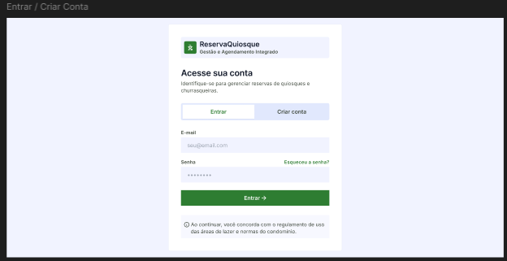
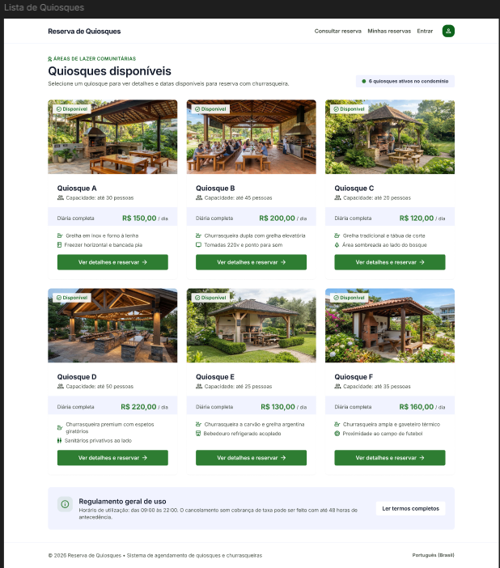
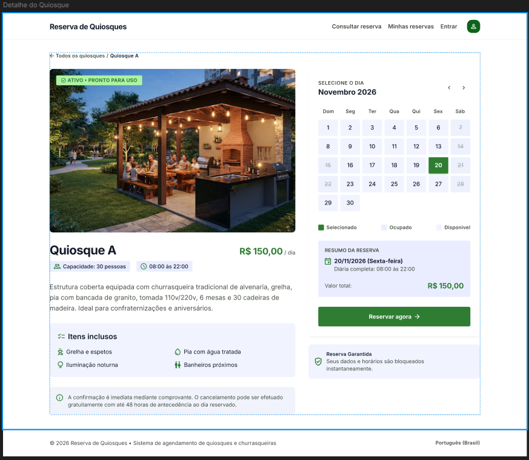
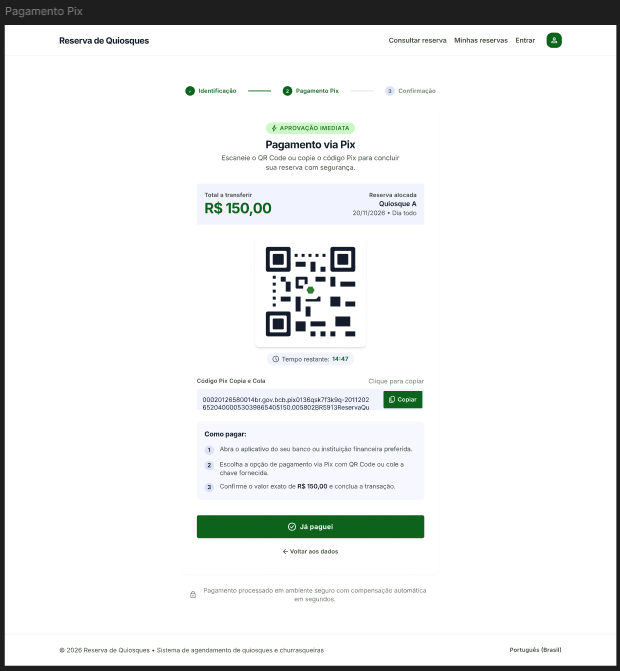
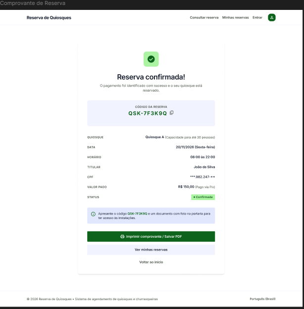
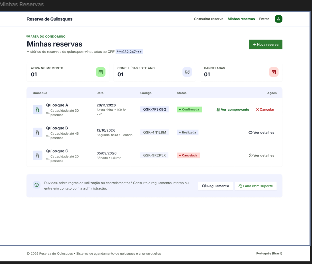
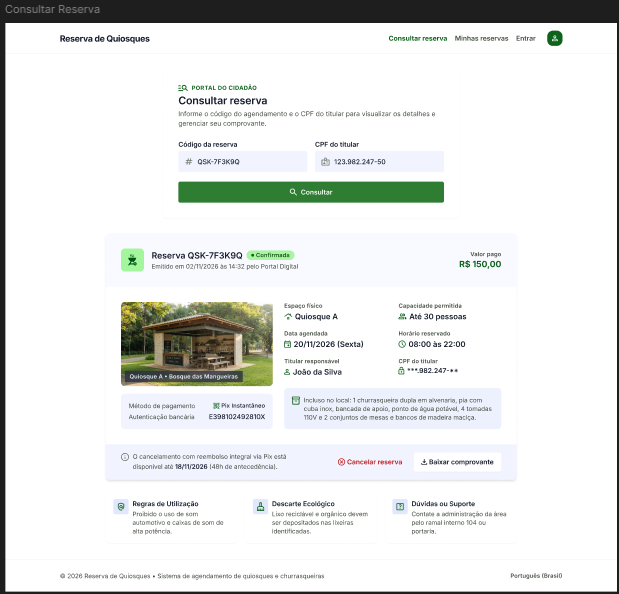
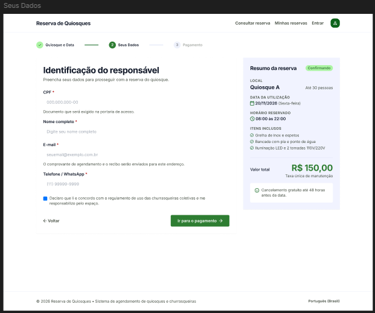

#  Protótipo de Interface

https://www.figma.com/design/XcScmvykeXCxQF483gxKgR/Sem-t%25C3%25ADtulo?node-id=0-1&p=f&t=3tnbNGrZ8H2WO1nX-0

---

#  Telas do Protótipo

##  Entrar / Criar Conta

  

---

##  Lista de Quiosques

  

---

##  Detalhe do Quiosque

  

---

##  Pagamento

  

---

##  Comprovante de Reserva

  

---

##  Minhas Reservas

  

---

##  Consulta de Reserva

  

---

##  Seus Status

  

