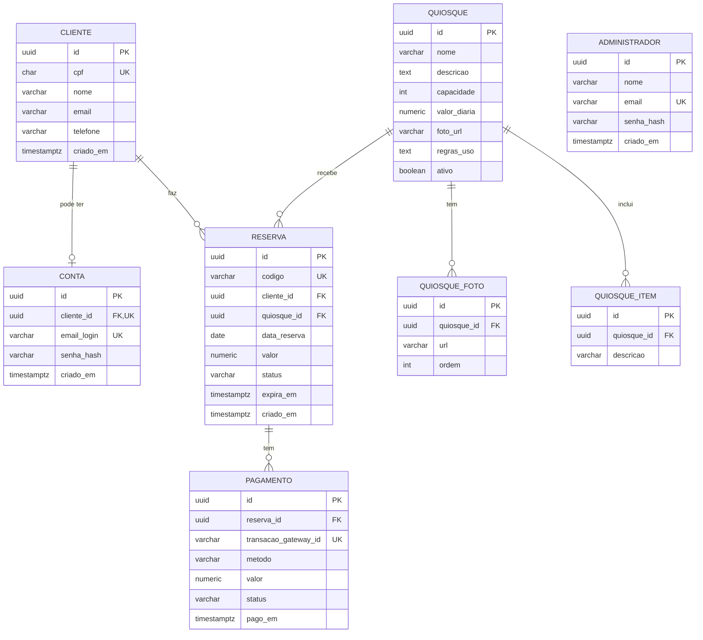

# 5. Modelagem de Dados (DER)

## Tipos e formatos

| Item | Definição |
|---|---|
| Valores em dinheiro | `numeric(10,2)` |
| Data e hora | `timestamptz` (gravado em UTC; regras de prazo usam o fuso `America/Sao_Paulo`) |
| `cliente.cpf` | `char(11)`, apenas os 11 dígitos, sem pontuação |
| Tamanhos de texto | `nome` 150 (cliente) e 100 (quiosque); `email` e `email_login` 254; `telefone` 20; `codigo` 10; `status` 20; `senha_hash` 100; `transacao_gateway_id` 100; `foto_url` e `url` 500; `quiosque_item.descricao` 150 |
| `reserva.codigo` | `QSK-` + 6 caracteres de `A-Z` e `2-9`, sem `O`, `I`, `0` e `1` para evitar confusão (ex.: `QSK-7F3K9Q`) |
| `quiosque.foto_url` | Foto de capa exibida na lista (RF01) |
| `quiosque_foto` | Galeria exibida no detalhe (RF02), ordenada por `ordem` |
| `status` e `pagamento.metodo` | Restritos aos valores das tabelas abaixo por `CHECK` |
| `administrador` | Separado das contas de cliente (RF11). Não se liga a `cliente` nem a reservas. Tamanhos: `nome` 150, `email` 254, `senha_hash` 100 |

## Relacionamentos

| Relacionamento | Cardinalidade | Observação |
|---|---|---|
| Cliente — Conta | 1 : 0..1 | A conta é opcional e cada CPF tem no máximo uma (RN09). |
| Cliente — Reserva | 1 : N | Um cliente pode fazer várias reservas. |
| Quiosque — Reserva | 1 : N | Um quiosque recebe várias reservas, em datas diferentes. |
| Quiosque — Quiosque_Foto | 1 : N | Fotos do detalhe do quiosque (RF02). |
| Quiosque — Quiosque_Item | 1 : N | Itens inclusos no quiosque (RF02). |
| Reserva — Pagamento | 1 : N | Guarda as tentativas de pagamento de cada reserva. |

## Status da reserva

| Status | Significado |
|---|---|
| `PENDENTE_PAGAMENTO` | Criada, aguardando o Pix. Bloqueia a data por 15 min (RN05). |
| `CONFIRMADA` | Pagamento aprovado (RN06) ou registrado pela administração (RN14). |
| `EXPIRADA` | Prazo de pagamento acabou. A data é liberada. |
| `CANCELADA` | Cancelada pelo cliente (RN07) ou pelo administrador (RN13). A data é liberada. |

"Realizada", exibida em "Minhas reservas", **não é um status gravado**: é como a tela mostra uma reserva `CONFIRMADA` cuja data já passou.

## Status do pagamento

| Status | Significado |
|---|---|
| `PENDENTE` | Cobrança Pix gerada, aguardando o pagamento. |
| `APROVADO` | Pagamento confirmado pelo gateway. |
| `REEMBOLSADO` | Valor devolvido ao cliente: cancelamento (RN07, RN13) ou pagamento após a expiração (RN11). |

## Método do pagamento

| Método | Significado |
|---|---|
| `PIX` | Pago via Pix pelo gateway (RF05). Reembolso pelo gateway. |
| `ADMINISTRACAO` | Registrado pelo administrador como pago na administração (RN14). `transacao_gateway_id` recebe um identificador interno (`ADM-` + código da reserva) e o reembolso é feito fora do sistema. |

## Restrições importantes

| Restrição | Regra que garante |
|---|---|
| `cliente.cpf` único | Um cadastro por CPF |
| `conta.cliente_id` único | RN09: uma conta por CPF |
| `conta.email_login` único | Login por e-mail (RF09) |
| `administrador.email` único | Login do administrador (RF11) |
| `reserva.codigo` único | RN10: consulta por código + CPF |
| Único em `(quiosque_id, data_reserva)` apenas para status `PENDENTE_PAGAMENTO` e `CONFIRMADA` | RN01: sem reserva duplicada ([ADR-001](04-adrs/ADR-001-banco-de-dados.md)) |
| `pagamento.transacao_gateway_id` único | RNF03: a mesma confirmação não é processada duas vezes |

O campo `reserva.valor` guarda o valor da diária no momento da reserva, para que mudanças futuras de preço não alterem reservas já feitas.

## Dados iniciais

Seis quiosques são cadastrados por migrations de dados (seed), com as capacidades e os valores do protótipo: Quiosque das Mangueiras, Pavilhão Central, Quiosque dos Ipês, Quiosque das Palmeiras, Quiosque Jardim dos Pássaros e Quiosque da Quadra (os "Quiosque A" a "F" do protótipo, nessa ordem). Depois disso, o administrador os mantém (RF16).

O primeiro administrador é criado quando a API sobe, com o login (e-mail ou usuário simples, ex.: `admin`) e a senha da configuração (`Admin:Email` e `Admin:Password`), caso ainda não exista. Não há tela para cadastrar outros administradores no MVP.
