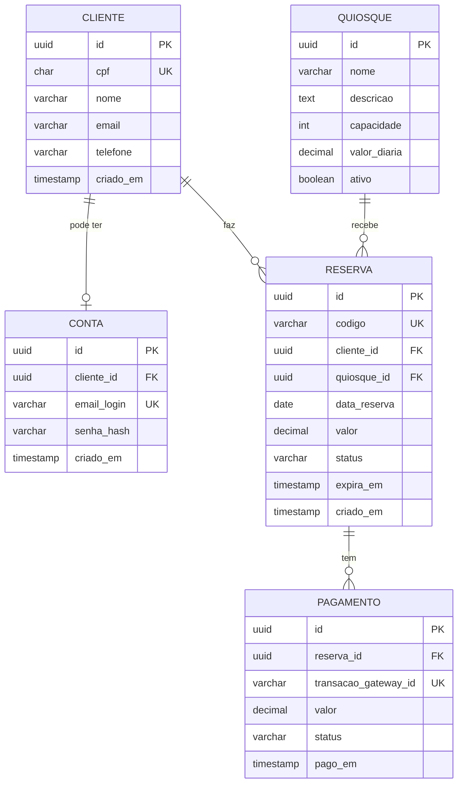

# 5. Modelagem de Dados (DER)

## Relacionamentos

| Relacionamento | Cardinalidade | Observação |
|---|---|---|
| Cliente — Conta | 1 : 0..1 | A conta é opcional e cada CPF tem no máximo uma (RN09). |
| Cliente — Reserva | 1 : N | Um cliente pode fazer várias reservas. |
| Quiosque — Reserva | 1 : N | Um quiosque recebe várias reservas, em datas diferentes. |
| Reserva — Pagamento | 1 : N | Guarda as tentativas de pagamento de cada reserva. |

## Status da reserva

| Status | Significado |
|---|---|
| `PENDENTE_PAGAMENTO` | Criada, aguardando o Pix. Bloqueia a data por 15 min (RN05). |
| `CONFIRMADA` | Pagamento aprovado (RN06). |
| `EXPIRADA` | Prazo de pagamento acabou. A data é liberada. |
| `CANCELADA` | Cancelada pelo cliente. A data é liberada. |

## Restrições importantes

| Restrição | Regra que garante |
|---|---|
| `cliente.cpf` único | Um cadastro por CPF |
| `conta.cliente_id` único | RN09: uma conta por CPF |
| `reserva.codigo` único | RN10: consulta por código + CPF |
| Único em `(quiosque_id, data_reserva)` apenas para status `PENDENTE_PAGAMENTO` e `CONFIRMADA` | RN01: sem reserva duplicada ([ADR-001](04-adrs/ADR-001-banco-de-dados.md)) |
| `pagamento.transacao_gateway_id` único | RNF03: a mesma confirmação não é processada duas vezes |

O campo `reserva.valor` guarda o valor da diária no momento da reserva, para que mudanças futuras de preço não alterem reservas já feitas.
